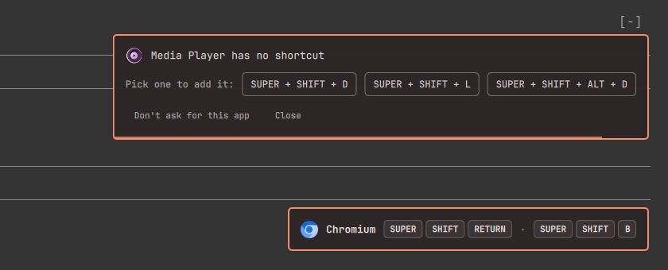
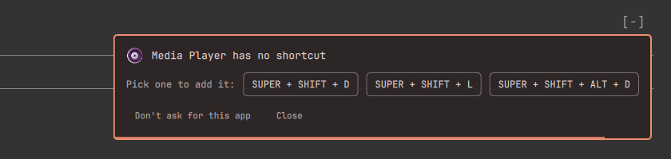

<div align="center">

# Keytip

**Learn your launch shortcuts as you open apps.**

An Omarchy shell plugin. When an app opens, a small card shows the keyboard
shortcut that launches it, then fades out. If the app has none, Keytip suggests
free combinations and adds the one you click.


<br><br>



</div>

## What it does

| | |
|---|---|
| **The app has a shortcut.** The card names it for 3.5 seconds and fades out. It cannot be clicked and never takes focus. | **The app has none.** The card suggests up to three combinations that are not bound to anything, and waits 12 seconds for a click. |
|  |  |

- Appears in the bottom corner of the focused monitor and fades out on its own.
- Follows the current Omarchy theme: colors, font, corner radius and spacing.
- Suggestions prefer `SUPER + SHIFT +` a letter from the app's name, where Omarchy keeps its app launchers, and are checked against every binding in your Hyprland config.
- A line along the bottom of the card shows the time left to choose. Hovering the card pauses it.
- Understands Omarchy's launchers: default browser, terminal and editor, web apps, TUIs and `launch-or-focus` bindings.
- Quiet by design:
  - the same app's shortcut is shown at most once an hour;
  - the offer to add a shortcut is made once per app per session;
  - **Don't ask for this app** turns the offer off for that app for good;
  - only apps with an entry in the app launcher get the offer, so dialogs and helper windows do not.
- English and Swedish. It follows the language set under Setup > Language.

## Install

```bash
omarchy plugin add https://github.com/PeterVinter/omarchy-keytip.git --enable --yes
```

Keytip then runs in the background. Preview the card without opening an app:

```bash
omarchy-shell keytip show chromium    # an app with a shortcut
omarchy-shell keytip show mpv         # an app without one
omarchy-shell keytip forget           # ask again for apps you dismissed
```

The argument is a window class, as listed by `hyprctl clients`.

## Remove

```bash
omarchy plugin remove peter.keytip
```

That deletes the plugin folder in `~/.config/omarchy/plugins/`. Two things are left for you to decide on:

- Shortcuts you added stay in `~/.config/hypr/bindings.lua`. Each one sits under a comment ending in `(added by Keytip)`; delete those lines to remove them.
- `~/.local/state/peter.keytip/` holds the list of apps you chose not to be asked about and the last backup of `bindings.lua`. Delete the folder to clear both.

## What it changes on your system

Keytip writes to your configuration only when you click a suggested combination. It then:

1. copies `~/.config/hypr/bindings.lua` to `~/.local/state/peter.keytip/bindings.lua.before`;
2. appends one binding to the end of `bindings.lua`:

   ```lua
   -- Media Player (added by Keytip)
   o.bind("SUPER + SHIFT + D", "Media Player", { launch = "mpv --player-operation-mode=pseudo-gui --" })
   ```

3. runs `hyprctl reload`, and restores the backup if Hyprland reports a config error.

Nothing else is written outside `~/.local/state/peter.keytip/`. Keytip uses no network and needs no root.

To find shortcuts it loads `~/.config/hypr/hyprland.lua` in a separate `lua` process against a stand-in for Hyprland's API and records the bindings it makes. Hyprland itself does not report what a Lua binding launches, so the config is the only source. This runs your Hyprland config as Lua each time an app window opens (about 50 ms), with a time limit.

## Requirements

- Omarchy 4.x with the Lua Hyprland config.
- `lua`, `hyprctl` and `bash`, all part of a standard Omarchy install.

## Settings

The timings are constants at the top of `Service.qml`:

| Constant | Default | Meaning |
|---|---|---|
| `knownMs` | `3500` | How long a known shortcut is shown |
| `askMs` | `12000` | How long the card waits for a choice |
| `resultMs` | `3000` | How long the confirmation is shown |
| `knownCooldownMinutes` | `60` | Minimum time between hints for the same app |

## Development

Logic lives in `Model.js` and is tested without a GUI:

```bash
node test/model.test.js
```

`scan-binds` prints the bindings Keytip sees, one per line, which is the quickest way to check why an app is or is not matched.

## License

MIT. See [LICENSE](LICENSE).
